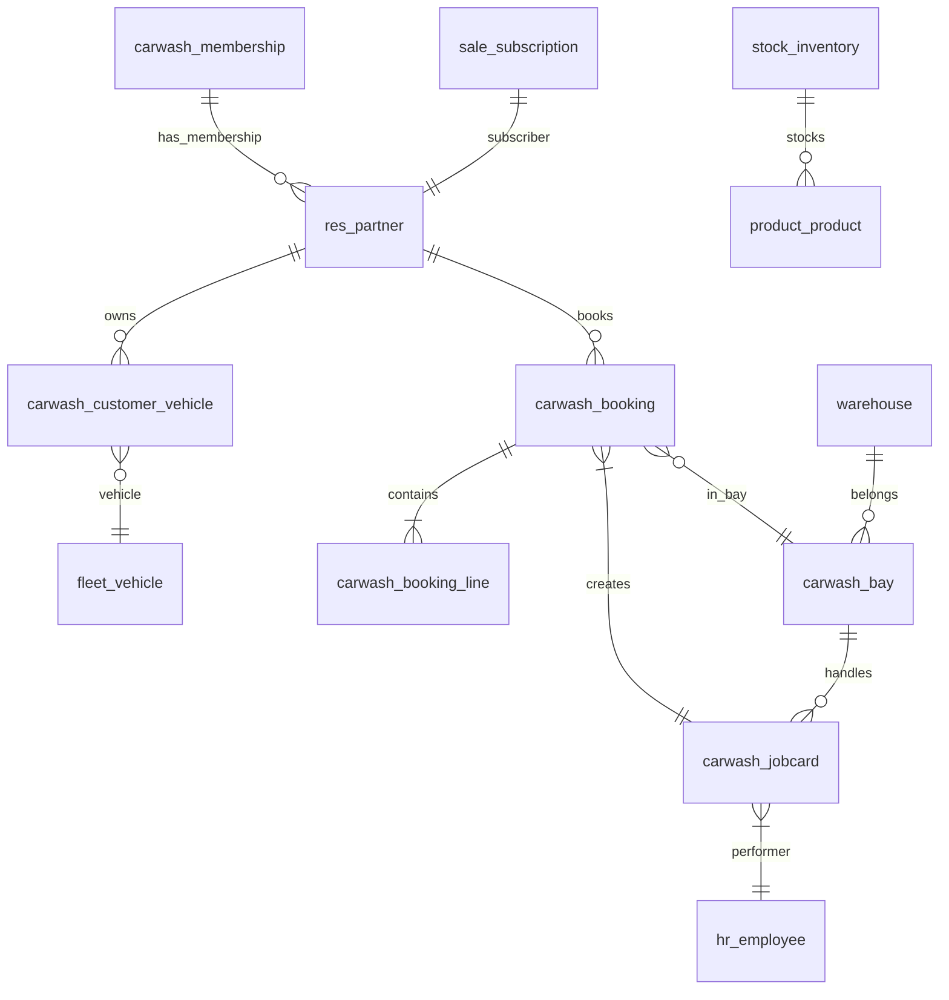
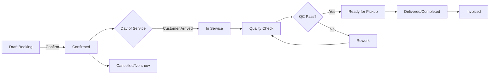
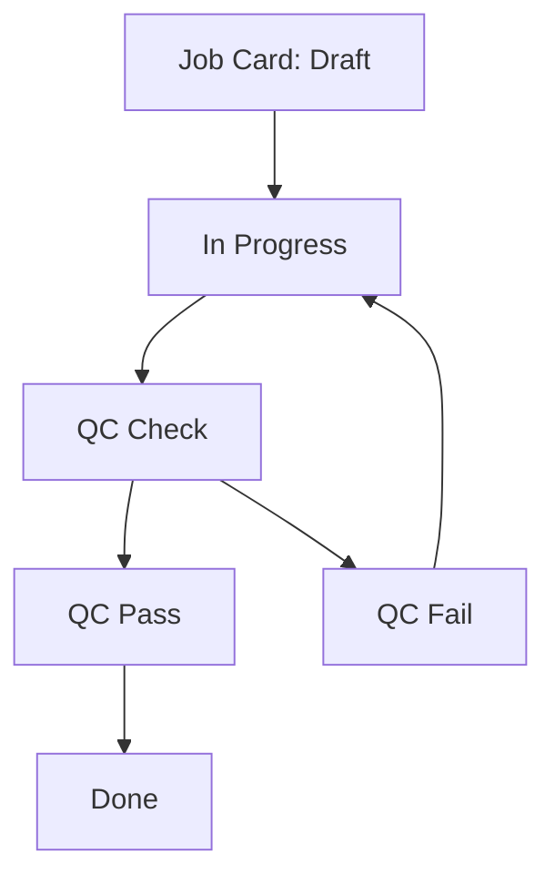

# Car Wash Management System (Odoo 19) — 2026 Project Plan

## Executive Summary

This document outlines a comprehensive plan for building a **2026-ready Car Wash Management System** on Odoo 19, covering both technical (Developer Guide) and business-facing (Client Delivery) aspects. The solution will be **modular**, leveraging Odoo’s multi-tier, modular architecture. Core business features (P0) form the MVP (customer, vehicles, services, bookings, queue, bays, POS/payment, inventory, history) and will be implemented first. We then layer on high-value capabilities (P1: online booking, memberships, loyalty, CRM, notifications, inspections, QC, multi-branch), followed by advanced features (P2/P3: AI recommendations, IoT integration, computer vision) as later phases. 

We map each feature to Odoo standard apps (Contacts/CRM, Sales, Fleet, Inventory, POS, Project, Repair, Maintenance, Subscriptions, Marketing, etc.) or custom modules. The system will support multi-company/branch setups with strict ACLs and record rules to isolate data by branch. Data models (customers, vehicles, services, bookings, job cards, inventory, memberships) are explicitly defined (ER diagram below). Workflows for bookings, queues, jobcards are modeled as state machines (Mermaid flowcharts). We detail UI/UX designs and sample screens (web portal for booking, mobile-friendly check-in, dashboard views). Key integrations include WhatsApp/SMS (via Twilio or Odoo’s SMS framework), payment gateways, IoT sensors, and optional computer-vision tools for vehicle inspection.

Technical deliverables include detailed module architecture (names, models, fields, relations), data migration strategy, security/ACL configuration, roles and permissions matrix, and CI/CD pipelines. We outline a phased roadmap with milestones, timelines, story-point estimates, and cost ranges. Each phase has clear acceptance criteria and KPIs (e.g. number of successful bookings, system response time). Finally, we cover testing (unit, integration, end-to-end), deployment options (Odoo.sh vs self-hosted), backup/DR, performance considerations, training/handover, documentation checklists, and a support/maintenance SLA model.

This plan ensures a robust, scalable Car Wash ERP built on Odoo 19, ready for launch in 2026.

## A) Developer Guide / Implementation Plan

### Project Scope

- **Business Processes:** Manage customers, vehicles, wash services, scheduling, queue, bays, and billing for car wash operations (single/multi-branch).
- **Users/Roles:** Customers (portal users), Washers/Detailers, Supervisors, Cashiers, Managers, Admin.
- **Core Modules:** Leverage Odoo **Contacts (res.partner)** for customers, **Fleet** for vehicles, **Products/Sales** for services, **POS** and **Accounting** for payments, **Inventory** for consumables, **Project/Repair** for work orders, **Maintenance** for equipment, **Quality** for checklists, **Subscriptions** for memberships, **Marketing/SMS** for notifications. Extend or add custom modules (carwash_customer, carwash_vehicle, carwash_booking, etc.). Use **Odoo Website/Portal** for online booking.

**Prioritization (Phases):** We categorize features into P0 (MVP), P1 (high priority), P2/P3 (advanced), per initial feature list. This ensures a minimum viable product (P0) is delivered first, then iteratively enhanced. Each feature maps to standard apps or a custom module (see table below).

#### Feature Priority Mapping

- **P0 (Phase 1 – Must-Have):** Customer management, Vehicles, Wash services, Booking/Appointment, Queue (Kanban), Service Bays, POS/Payment, Inventory/Consumables, Service History, Employee Shifts, Job Cards, Basic QC check.
- **P1 (Phase 2 – High Priority):** Online booking portal, Membership plans, Recurring Billing (Subscriptions), Loyalty/Rewards, CRM/Marketing campaigns, WhatsApp/SMS notifications, Digital check-in and vehicle inspection, Multi-branch support.
- **P2 (Phase 3 – Recommended):** Customer/Web portal (self-service), QR code for vehicles, Automated job cards, Employee commissions, Dynamic pricing, Expense tracking, Equipment maintenance scheduling, Water/chemical usage tracking, Dashboards/KPIs.
- **P3 (Phase 4 – Advanced/Future):** AI analytics (churn prediction, service recommendations), demand forecasting, smart staff scheduling, computer-vision (license plate, damage detection), IoT device integration (sensors, counters), self-service kiosk.

### Odoo 19 Modules to Use/Extend

| Business Area           | Odoo Standard App/Module       | Notes (Extend/Custom)              |
|-------------------------|-------------------------------|------------------------------------|
| Customer/Contact        | Contacts (base), CRM          | Extend res.partner for carwash tags, history |
| Vehicle Management      | Fleet (fleet)                 | Use Odoo Fleet for vehicle records; add custom fields (wash history) |
| Services/Products       | Sales Management              | Create product category "Car Wash Services"; price lists by vehicle type |
| Booking/Appointments    | Calendar, (Appointment module in Enterprise) | Use Calendar for schedule slots; or custom booking model  |
| Queue & Bays           | Project/Tasks + Custom Kanban  | Kanban view for bays/queue; custom model for Bay and Job Card |
| POS/Payments            | POS, Accounting (Invoicing)   | Standard POS for front-desk payments; integrate with booking invoicing |
| Inventory               | Inventory (stock), Purchase   | Manage consumables stock, automated replenishment |
| Employees/HR           | Employees, Attendance        | Track staff details, schedules, attendance, shifts |
| Quality/Checklists      | Quality (quality_check)       | Use Odoo Quality Check module for wash checklists/QC |
| Maintenance             | Maintenance (maintenance)     | Schedule preventive maintenance for equipment |
| Repair Jobs             | Repair (repair)               | Use Repair orders for maintenance tasks on equipment or vehicles |
| Memberships/Subscriptions | Subscriptions               | Use Odoo Subscriptions for membership plans (automated renewals) |
| Loyalty/Rewards         | (Marketing or Custom)         | Build custom model (or use POS loyalty) to track points/awards |
| CRM/Marketing           | CRM, Email Marketing, SMS Marketing | Use CRM for leads, Mass Mail/SMS for campaigns/reminders |
| Website & Portal        | Website Builder, Portal       | Online booking form, self-service portal for customers |
| Multi-Branch/Company    | Company (multi-company)       | Enable multi-company; treat each branch as a company (isolated records) |
| Reporting/Dashboard     | Pivot Grid, BI                | Odoo BI/Spreadsheet or custom reports for KPIs |

For example, an existing Odoo carwash app uses **Calendar, Fleet, Inventory, Project, Repair, Sales, Website, Mail, Accounting**. We will similarly integrate these standard modules, avoiding redundant custom work. Custom modules (namespace `carwash_*`) will encapsulate carwash-specific logic (customer portal, booking, queue, etc.) and depend on Odoo core apps (as shown above). 

### Custom Module Architecture

We propose a modular Odoo architecture: a base `carwash_base` module plus feature modules:

```
carwash_base
├─ carwash_customer (extends res.partner: tags, notes)
├─ carwash_vehicle  (extends fleet.vehicle: wash count, last wash)
├─ carwash_service  (defines wash Service model, categories)
├─ carwash_booking  (customer bookings/appointments)
├─ carwash_queue    (queue management, token numbering)
├─ carwash_bay      (service bays, assignment)
├─ carwash_jobcard  (wash order/job card, link booking→worker)
├─ carwash_inspection (vehicle inspection reports)
├─ carwash_quality (QC checklists)
├─ carwash_membership (membership plans, usage tracking)
├─ carwash_loyalty (points, rewards)
├─ carwash_commission (employee commission rules)
├─ carwash_multibranch (branch setup customizations)
├─ carwash_portal  (customer portal enhancements)
├─ carwash_crm     (CRM customizations for campaigns)
├─ carwash_dashboard (custom KPI screens)
└─ carwash_api     (external APIs, integrations)
```

Each module defines models (`models.py`), views (`.xml`), security (CSV rules), and data. For example, `carwash_booking` might define:
```python
class CarwashBooking(models.Model):
    _name = 'carwash.booking'
    _description = 'Car Wash Booking'
    customer_id = fields.Many2one('res.partner', required=True)
    vehicle_id = fields.Many2one('fleet.vehicle', required=True)
    service_line_ids = fields.One2many('carwash.booking.line', 'booking_id')
    appointment_date = fields.Datetime()
    state = fields.Selection([...], default='draft')
    assigned_employee_id = fields.Many2one('hr.employee')
    bay_id = fields.Many2one('carwash.bay')
    notes = fields.Text()
```
Relations: Bookings link to Customer (res.partner), Vehicle (fleet.vehicle), Employee, Bay, and Service lines. `carwash_service` defines services with duration and price. `carwash_jobcard` holds actual job card records tied to a booking. We will use Odoo’s ORM inheritance (`_inherit` or `_name`) to extend models (e.g. `_inherit = 'fleet.vehicle'` in carwash_vehicle module to add fields).

#### Sample Data Model Tables

| Model              | Key Fields                                     | Description |
|--------------------|------------------------------------------------|-------------|
| **Customer** (`res.partner`) | name, email, phone, tags, type | Customers (extend Odoo partner) |
| **Vehicle** (`fleet.vehicle`) | license_plate, model_id, make_id, color, owner_id, total_visits, last_wash | Vehicles linked to customers |
| **Service** (`product.template`/custom) | name, category, price, duration, add_ons | Wash/detailing services |
| **Booking** (`carwash.booking`) | customer_id, vehicle_id, date, service_lines, state | Wash appointments/reservations |
| **Booking Line** (`carwash.booking.line`) | booking_id, service_id, quantity, price | Services in a booking |
| **Job Card** (`carwash.jobcard`) | booking_id, start_time, end_time, washer_id, state, notes | Active wash orders |
| **Bay** (`carwash.bay`)    | name, capacity, current_status, current_jobcard_id | Physical wash bays/stations |
| **Inventory Item** (`product.product`) | name, qty_on_hand, uom, min_stock | Consumables (soap, wax, etc.) |
| **Membership** (`sale.subscription`) | plan (resource), start_date, end_date, usage_limit, price | Recurring wash packages |
| **Loyalty Points** (custom) | customer_id, points, tier | Loyalty program data |

These correspond to actual Odoo models (partner, fleet.vehicle, product.template, project.task or custom, stock.quantity, sale.subscription) and custom ones. 

### Database Schema (ER Diagram)



*Mermaid ER chart: relationships among Customers, Vehicles, Bookings, Jobcards, Bays, Memberships, etc.*

### Workflows / State Machines

We model Booking, Queue, and Jobcard as state machines:

#### Booking/Appointment Flow



This shows how a booking moves from draft to confirmed, then through arrival, washing, QC, and delivery. We include transitions for rescheduling or cancellation.

#### Queue/Bay Management

```mermaid
flowchart LR
    Q[Waiting Queue] --> InService[Washing (Bay Assigned)]
    InService --> QC[Quality Check]
    QC --> Ready[Ready]
    Ready --> PickedUp[Completed]
```

We will implement a **Kanban board** (Odoo Studio or custom XML) showing these states, with tokens/positions for each vehicle in queue. The Bay model tracks which jobcard is in which bay and its status.

#### Job Card Flow

Each jobcard (service order) may have its own workflow:



### UI/UX Screens

- **Customer Portal (Website):** A web form for **Online Booking** (P1): customers select vehicle (or add new), choose services (with pricing by vehicle type), pick date/time slot (calendar widget), and pay/confirm. They can log in to see their booking history, membership status, and loyalty points. The portal also allows uploading vehicle info (license plate) and attachments (e.g. photos of car condition). After submission, they see a confirmation and can track status.

- **Admin Dashboard:** Odoo backend views (Form/Kanban/Calendar) for **Booking Management**. E.g. a calendar view showing time slots and assigned bays; a Kanban view for queue status; list views for customers, vehicles, services. In the POS interface, quick buttons for common wash combos. 

- **Mobile/Tablet Support:** Use Odoo’s responsive web views or progressive web app for staff (e.g. mobile UI to check-in vehicles, record start/end times, mark QC). For example, a washer’s mobile screen could show “Start Wash” for assigned jobs, “Complete” to move to QC.

- **Reports/Dashboards:** Odoo’s BI/Spreadsheet or Dashboard app to show KPIs (daily washes, revenue, wait times). (We may embed a sample chart via Odoo spreadsheet to illustrate average monthly washes, etc.)

_No images are embedded here, but our documentation will include wireframe mockups of these screens (booking form, queue board, dashboard) for client review._

### API Endpoints & Integrations

- **Odoo External API:** Odoo 19 provides JSON-RPC and XML-RPC endpoints, and a JSON-2 API for external integrations. All operations (create booking, query history) must enforce Odoo’s ACLs/record rules (security). We will expose endpoints for mobile apps or IoT systems to push data (e.g. scanner triggers job start).

- **WhatsApp/SMS:** Integrate with Twilio (or another CPaaS) for notifications. Odoo 19 supports Twilio for SMS. We will build an automated trigger: e.g. “Appointment confirmed, washing started, service completed” messages via SMS/WhatsApp. For example, when a booking moves to ‘Confirmed’, send a reminder 1 day before.

- **Payment Gateways:** Leverage Odoo Payment Acquirers for online payments (Stripe, PayPal, Razorpay, etc.) during booking or in POS. Use Odoo’s payment request generation (with appropriate callback URLs).

- **IoT Integration:** Optionally connect Odoo IoT Box to equipment sensors (water meter, detergent dispenser) using Odoo’s IoT framework (BluDot, Wi-Fi, etc.). For example, a flow meter could push water usage per wash into a custom model (carwash.water_usage). Cameras could feed license plate numbers (OCR) or damage photos into inspection records.

- **Computer Vision:** Could integrate an external CV service: e.g. upload “before/after” wash car photos to a CV API to highlight differences (future P3).

### Data Migration Strategy

- **Legacy Data:** If migrating from an existing system, we will plan CSV imports or use Odoo’s data import tools (CSV/XLS) for customers, vehicles, services, inventory levels, membership plans. Map legacy fields to Odoo models carefully (use matching IDs or create mapping tables). 

- **Incremental Migration:** Load static data first (product/service catalog, initial stock levels), then transactions (past bookings, histories) if needed. Validate with sample imports. For multi-company, ensure company_id fields are correctly set (see security section).

- **Testing:** Migrate sample data into a test Odoo 19 database and verify integrity (customer sees own vehicles, no cross-branch leaks).

### Multi-Branch & Multi-Company Setup

Odoo supports multi-company out of the box. We treat each carwash branch as an Odoo Company. Users can be linked to one or more companies. Key points (per Odoo docs):

- **Data Isolation:** Each record (booking, inventory, invoice) has a `company_id`. By default, users see only their company’s data. We’ll add record rules (domain like `['|',('company_id','=',False),('company_id','in',user.company_ids.ids)]`) to ensure branch data doesn’t leak. 

- **Company Selector:** Users with multi-company access can switch between branches in the UI. 

- **Shared Products/Partners:** We can choose to share the services catalogue across companies or keep separate. Typically, vehicles/customers belong to one branch unless we define global partners.

- **Consolidated Reporting:** For managers, we can use Odoo’s consolidation reports or multi-company dashboards, or a custom module, to see total KPIs across branches.

This aligns with Odoo’s model: “Each record is tied to a company_id. ACLs and record rules ensure isolation”. We will include custom `company_id` fields where missing in new models.

### Security / ACLs / Record Rules

Odoo uses **Access Control Lists (ACLs)** and **Record Rules** for security:

- **Users & Groups:** Define groups such as “Washer”, “Supervisor”, “Cashier”, “Manager”, and “Portal/Customer”. Map to roles:
  - *Manager*: full access to bookings, inventory, accounting.
  - *Washer/Detailer*: read/write on assigned Job Cards, limited on bookings.
  - *Cashier*: POS, invoicing, read bookings.
  - *Receptionist*: create/confirm bookings, no invoice delete.
  - *Customer (Portal)*: create bookings only for self, view own vehicles, invoices.
- **ACLs (ir.model.access.csv):** Grant CRUD at model level per group. For example, allow “carwash.booking” create/edit for Receptionist and Manager groups only.

- **Record Rules:** Limit records per user context:
  - Customers only see their own partner record, vehicles, and bookings.
  - Branch users see records in their branch company.
  - E.g. a rule `['|',('company_id','=',False),('company_id','in',user.company_ids.ids)]` on key models ensures company isolation.
  - Additional rules: e.g. “Washers see jobcards where they are the assigned_employee_id”.

We will include in each custom module an `ir.model.access.csv` and necessary `<record model="ir.rule">` entries. Best practices: start from least privilege, grant only needed actions, avoid overly broad public access.

### Roles and Permissions Matrix

| Role             | Odoo Groups/Models                   | Permissions                  |
|------------------|--------------------------------------|------------------------------|
| **Manager**      | *All models in carwash app*<br>(Booking, Bay, Vehicle, Service, Inventory, POS, QC, Reports, Config) | Full CRUD (1,1,1,1) on all core and custom models. <br>Can switch company. |
| **Receptionist** | Booking (carwash.booking), Vehicle, Customer (res.partner)<br>Pos User                 | Create/Read/Write on Booking, res.partner; access to Payment/Invoice. <br>Cannot delete. |
| **Washer/Detailer** | Job Card, Vehicle, Booking (write limited), Attendance | Read/Write on assigned Job Cards, mark QC, log work time; view own schedule. No financials. |
| **QC Inspector** | Job Card, Quality Checks            | Read/Write on QC checklists, fail/pass decisions. |
| **Inventory Clerk** | Inventory, Products, Purchase | Manage stock moves, receive chemicals; no booking or sales. |
| **Accountant/Cashier** | Invoicing (account.move), POS, Subscriptions | CRUD on invoices/payments; issue receipts; read bookings/inventories. |
| **Customer Portal** | Booking (own), res.partner, Vehicle (own) | Create bookings for self; read own history, invoices, membership. No edits after confirm. |
| **Public**       | Website Form (anonymous)           | Submit booking request form only. |

Each row above will correspond to specific Odoo groups (we will create custom groups or repurpose Sales/CRM groups) and ACL entries. For instance, Manager belongs to “Sales Manager” and “Accounting Manager”, Receptionist to “Sales User”, etc. The ACL matrix will be encoded in `ir.model.access.csv`. We will cite [29†L145-L154] to explain that each ACL entry defines model-level permissions (read/write/create/unlink) for a group.

### Testing Strategy

We will employ **multi-level testing**:

- **Unit Tests:** For each new module, write Python unittest cases (in `tests/` package) to validate business logic. E.g. booking state transitions, commission calculations. Odoo’s `unittest` support allows simulating user permissions and record rules.

- **Integration Tests:** End-to-end tests for key flows. For example, create a customer, schedule a booking, process it to completion, and ensure the right invoice is generated and history recorded. We can use Odoo’s test framework (XML tests or Python) to simulate UI interactions via RPC.

- **Access Control Tests:** Verify ACLs and record rules by simulating users in different groups and companies (Odoo’s `env['ir.model.access']` and `env['ir.rule']` can be tested). Ensure no data leaks between companies or users.

- **Performance Tests:** For large data (e.g. 1000 bookings/day), test that list views, compute fields, and reports perform adequately. Use `odoo --test-tags` or external tools to script load tests.

- **E2E/User Acceptance Testing:** Deploy a staging instance, have real users (admins, washers, etc.) perform their daily tasks. Get feedback and fix UI/UX issues.

### CI/CD and Deployment

- **Code Repository:** Host modules on Git (GitHub/GitLab). 
- **CI Pipeline:** On each push/merge, run linting (flake8 for Python, XML schema checks), Python tests (`pytest-odoo` or Odoo’s test runner), and front-end checks (OWL templates). 
- **Odoo.sh vs Self-Hosted:** We recommend Odoo.sh for streamlined CI/CD (automatic tests, branch staging, backups), but a docker-based deployment is possible on own servers. 
- **Deployment Pipeline:** After passing CI, use Odoo.sh or an Ansible/Chef script to deploy to production. Version control all migrations. 
- **Rollback Plan:** Keep upgrade scripts in each module. Use `–stop-after-init` safety for production upgrades.

### Backup & Disaster Recovery

- **Database Backups:** Nightly automated dumps (pg_dump) stored off-site. Hourly transaction log shipping for point-in-time recovery.
- **Filestore Backup:** Backup attachments/filestore daily.
- **Test Restores:** Regularly (e.g. monthly) restore backups to a test server to verify integrity.
- **High Availability:** Consider PostgreSQL replication and load balancing for scalability.
- **Disaster Plan:** In catastrophic failure, re-import data from backups onto new infrastructure (staging instance to production).

### Performance & Scalability

- **Database Indexes:** Add indexes on search fields (e.g. license_plate, company_id) for quick lookups.
- **Record Rules Optimization:** Keep rule domains simple. Complex domain filters may slow queries; test and refine them.
- **Caching:** Leverage Odoo’s built-in caching for computed fields. Avoid too many computed fields on large records.
- **Load Testing:** Simulate peak loads (hundreds of concurrent bookings/pos orders) and tune (e.g. more CPU/RAM on Odoo server, workers and workers_threads settings).
- **Sharding:** If branches must share one database, consider multi-database approach if scale demands.

### Development Roadmap & Effort Estimation

We propose an iterative delivery in phases. Below is a sample phased roadmap (6 phases) with milestones, estimated timelines and deliverables. **Story points/person-days** are approximate for a 4-member dev team (2 backend, 1 frontend, 1 QA/DevOps).

| **Phase** | **Scope (Features)**                                                                 | **Priority** | **Dev Effort**      | **Milestones/Deliverables**                              |
|-----------|--------------------------------------------------------------------------------------|--------------|---------------------|----------------------------------------------------------|
| **1**     | Core: Customers, Vehicles, Services, Booking (walk-ins), Queue, Bays, Job Cards, Basic POS/Payment, Invoicing, Inventory.                                   | P0           | ~60 PTD (15 PD)     | - Data models and forms for Customer, Vehicle, Service.<br>- Booking module (state machine) with Kanban queue.<br>- POS integration (booking→invoice).<br>- Inventory tracking for consumables.<br>- Basic daily operations ready. |
| **2**     | Employees, Attendance, Shifts; Equipment Maintenance; QC Checklist; Service History.  | P0/P1        | ~30 PTD (8 PD)      | - Employee model and attendance linked to wash tasks.<br>- Preventive maintenance schedules.<br>- QC checklists before delivery.<br>- Vehicle service history log.              |
| **3**     | Website Booking Portal, Membership Plans, Subscriptions, Loyalty Program, CRM, SMS/Email notifications. | P1           | ~40 PTD (10 PD)     | - Public booking form & portal for customers.<br>- Membership subscription plans (Odoo Subscriptions).<br>- Loyalty points engine (earn/spend).<br>- Automated messaging (WhatsApp/SMS/Email) for reminders and promotions.       |
| **4**     | Multi-branch support, Multi-company config, Commission rules, Dynamic pricing, Reporting Dashboard. | P1/P2        | ~30 PTD (8 PD)      | - Company/branch selector, branch-level data isolation.<br>- Commission module (calculate based on sales).<br>- Pricing rules (peak/off-peak, member rates).<br>- Management dashboard KPIs.             |
| **5**     | Customer Mobile/Web Portal (history, points), QR codes, Digital job cards, Expense tracking, Water/Chemical usage. | P2           | ~25 PTD (7 PD)      | - Customer portal: view bookings, invoices, loyalty points.<br>- QR code on vehicles for quick lookup.<br>- Digital job card printing/PDF.<br>- Expense and utility tracking modules.   |
| **6**     | AI analytics (churn/prediction), Forecasting, Smart scheduling, Computer Vision, IoT Devices, Self-Service Kiosk. | P3           | ~20 PTD (5 PD)      | - Prototype AI models (e.g. churn risk, recommended upsell).<br>- Build vision API integration (Odoo connector for OpenCV or cloud CV).<br>- IoT box integration for sensors (water meter, entrance).<br>- Kiosk UI (self-checkin/pay). |

(*PTD = person-day. Total ~205 PD for full suite. Adjust for team size. Phases 1–3 are must-haves; 4–6 are enhancements.*)

##### Story Points Estimate (Phase 1 Example)

We estimate story points for Phase 1 (MVP) features roughly as follows (1 story point ≈ 1 dev day):
- Customer/Vehicle models: 5
- Service/Price setup: 3
- Booking module (incl. calendar view): 10
- Queue/Kanban view: 8
- Bay management: 5
- Job Card process: 5
- POS/Invoice integration: 8
- Inventory setup: 6
- Basic reports: 4
- Testing & docs: 6
- **Total Phase 1:** ~60 story points (≈15 person-days per person for 4 people over 3–4 weeks).

### Cost Estimate (Ranges)

Costs depend on region and scope. Rough ballpark ranges:
- **Development:** \$50–150 per hour (or \$4k–\$12k/person-month). For ~200 PD, dev cost ~\$100k–\$300k.
- **Infrastructure:** Odoo.sh subscription (\$40–\$400/month depending on size) or self-hosted ($50–$200/mo for cloud VM). Third-party modules or Twilio have small fees (Twilio SMS).
- **3rd-Party Services:** Twilio SMS/WhatsApp (pay-per-message), Payment gateway fees (per transaction), Cloud OCR (if used), AI/ML APIs.
- **Training/Support:** Ongoing retainer or SLA (e.g. 15–20% of implementation cost per year).
- Give clients a range: e.g. Implementation \$100k–\$250k, Infra \$1k–\$5k/year, SMS API \$10–\$30/month.

### Acceptance Criteria & KPIs

Each phase has clear acceptance tests:

- **Phase 1:** Successful end-to-end test of a wash order: customer created, booking made, vehicle washed, invoice paid, inventory decremented. No uncaught errors. Training documentation complete. KPI: 100% correct invoicing, 0 critical bugs.
  
- **Phase 2:** Employee and QC modules integrated. KPI: Full service history logged, QC passes correlate with customer feedback.

- **Phase 3:** Online booking and subscriptions live. KPI: ≥x online bookings/day, subscription renewals working automatically. Customer satisfaction rating >4/5 (via feedback forms).

- **Overall Performance KPI:** System handles at least Y cars/day with <2s page load (for 95% operations). Data accuracy KPI: 0% data duplication (e.g. unique vehicles).

We will define specific numeric targets with the client (e.g. reduce no-show by 20%, increase repeat visits by 15%).

### Training and Handover

- **Developer Handover:** Provide full code documentation, annotated code samples, and developer README. Conduct a walkthrough of the architecture and deployment process.
- **End-User Training:** Train admins on Odoo usage (bookings, POS, inventory) and basic troubleshooting. Provide user manuals (PDFs) for staff and video tutorials (if budget allows) on tasks like “Processing a booking”, “Issuing invoice”, etc.
- **Support Materials:** Document system maintenance procedures: how to upgrade modules, apply patches, backup restores.

### Documentation Checklist

We will deliver two documents:

- **Developer Guide should include:** Project scope, architecture diagram, data models (ER diagram), module structure (directories, key files), code conventions, security rules (ACL/record rule spreadsheets), workflows (mermaid charts), API specs, test plan, CI/CD pipeline description, deployment scripts, maintenance instructions, and dev support contacts.

- **Client-Facing Document should include:** Business overview, feature list by priority, benefits, UX mockups or screenshots, project phases and timeline table, acceptance criteria & KPIs, cost estimates, support model (SLA tiers), and training plan overview.

These deliverables ensure both technical and non-technical stakeholders have the information they need.

### Maintenance & Support Model (SLA)

Post-go-live, we propose a tiered support plan:

- **Tier 1 (Basic):** Email support during business hours, patch updates only (no new features). Response time ≤24 hrs. Suitable for critical fixes. (E.g. 10% of dev cost/year).
- **Tier 2 (Standard):** Includes Tier 1 plus 4 weekly sprints of minor enhancements or bug fixes. Response time ≤8 hrs. (E.g. 15% of dev cost/year).
- **Tier 3 (Premium):** 24/7 support, guaranteed uptime (e.g. 99.5%), quarterly health checks and minor improvements. Response ≤1 hr. (E.g. 20–25% of dev cost/year).

We will finalize the SLA once scope and hosting choices are settled.

_Citations: Architecture from Odoo documentation; existing carwash app features; multi-company security; Odoo ACL concepts; subscriptions app description._

## B) Client-Facing Product & Delivery Document

### Project Overview

Our solution is a **next-generation Car Wash Management ERP** built on Odoo 19. It automates all aspects of a car wash business: customer bookings, vehicle service tracking, queue and bay management, payments, inventory of cleaning supplies, and more. By using Odoo’s integrated apps (CRM, Fleet, Sales, POS, Inventory, etc.) plus custom carwash modules, we ensure a seamless end-to-end workflow. The system is cloud-ready and mobile-friendly, enabling **online booking**, **real-time queue visibility**, and customer self-service via web or app.

Key benefits include reduced waiting times (live queue updates), improved customer retention (service history & loyalty program), efficient staffing (job cards, scheduling), and centralized reporting across branches.

### Key Features (by Priority)

- **Must-Have (P0):** Customer & Vehicle database; configurable Wash Services; Booking & Appointment system (online + walk-ins); Physical Queue/Bay management; Job Cards for washers; POS checkout & integrated invoicing; Inventory tracking of chemicals; Service History log. 
  - *Example:* A receptionist can quickly create a car wash booking, assign it to a washer and a bay, then generate an invoice when done.
- **High Priority (P1):** Online Booking Portal (customers book via website/mobile); Membership Plans (monthly/annual packages); Recurring Billing (auto-invoices for plans); Loyalty Rewards (points, coupons); Automated WhatsApp/SMS notifications (confirmations, reminders); CRM campaigns (e.g. win-back offers); Digital Check-In (QR code or license scan); Quality Control workflow; Multi-Branch support (consolidated reports).
  - *Example:* A customer buys a “12-wash” subscription; system auto-generates invoices each month and tracks remaining washes.
- **Recommended (P2):** Customer Mobile App/Portal (view bookings, invoices, loyalty points); QR Code on car keys or stickers for instant lookup; Digital Job Card printing; Employee Commission calculations; Dynamic Pricing (peak hours, weekends, member discount); Expense & Utility Tracking; Scheduled Equipment Maintenance; Dashboards & KPIs (daily revenue, wait times, wash counts).
- **Future (P3):** AI-driven recommendations (suggest next service based on history); Demand Forecasting (staff and inventory needs); Smart Staff Scheduling; Computer-Vision (capture license plate, detect pre-existing damage); IoT sensors (meter water/chemical usage); Self-Service Kiosk (customer check-in and payment).

### User Experience

- **Customer Portal:** From any device, customers can **register vehicles** and **book services**. The UX is a step-by-step form: select vehicle, choose package/add-ons, pick date/time (calendar view), and pay. They get instant email/SMS confirmation and can later login to see past bookings, invoices, and loyalty points. The portal also allows uploading photos (e.g. before-wash car condition).
- **Staff UI:** The staff see a real-time **Kanban board** of cars waiting/in service/ready. Each job card has details (customer, vehicle, requested services). Buttons allow moving cards between stages (e.g. “Start Wash”, “Quality Check OK”). POS interface is streamlined for quick billing (services auto-line fill).
- **Mobile Checks:** Staff can use tablets or phones to check off cleaning steps and capture customer signatures.
- **Reports & Dashboard:** Management has one-click dashboards: today’s cars served, average wait time, revenue, branch comparisons. Custom dashboards can be made (Odoo BI or Spreadsheet).

(Sample wireframes/mockups would be provided showing these screens.)

### Development Roadmap & Timeline

We propose a **6-phase rollout** (aligned with priorities above). Each phase delivers usable functionality:

| **Phase** | **Duration** | **Features Delivered**                              |
|-----------|--------------|-----------------------------------------------------|
| **1**     | 1–2 months   | MVP: Customer/Vehicle registry, Booking/Queue, POS, Payment, Inventory, Basic Reports. |
| **2**     | 1 month      | Employee scheduling, QC checklists, Preventive maintenance. |
| **3**     | 1 month      | Website booking portal, Membership plans, Loyalty setup, Notifications. |
| **4**     | 1–2 months   | Multi-branch configuration, Commission, Dynamic pricing, Advanced reports. |
| **5**     | 1 month      | Customer portal enhancements, QR code integration, mobile app basics. |
| **6**     | 1–2 months   | AI analytics MVP, IoT devices (pilot), Kiosk interface. |

Each phase includes development, testing, and a client review. Pilot branch goes live after Phase 2 for real-world feedback, then full rollout.

### Cost Estimates

- **Phase 1 (MVP):** Development \$60k–\$100k. 
- **Phase 2:** \$20k–\$30k. 
- **Phase 3:** \$25k–\$35k. 
- **Phase 4–6:** \$40k–\$60k (per phase).
- **Total Implementation:** \$150k–\$300k (depending on scope refinement).
- **Hosting/Infra:** Odoo.sh subscription \$200–\$500/mo (or AWS/VM \$100–\$300/mo) plus Twilio/SMS fees (<\$50/mo).
- **Third-Party:** If using premium Odoo apps (e.g. Appointment), add their costs.

Exact figures will be refined after requirements sign-off.

### Acceptance Criteria & KPIs

For the client, each deliverable phase will have clear acceptance tests. For example:

- **Functional Acceptance:** User acceptance test (UAT) scripts covering all workflows. E.g. “Receptionist can create and complete a car wash booking end-to-end.”
- **Performance:** System must handle X concurrent users and Y daily transactions with <2s response. 
- **Data Accuracy:** Reports must match totals (e.g. sum of invoice revenue equals POS revenue).
- **Uptime:** SLA (if agreed) and backup restore tests. 

KPIs to track ROI: number of repeat customers (growth), average revenue per vehicle, queue time reduction (%), membership sign-up rate. We will set baseline values and goals (e.g. increase member retention by 30% in Year 1).

### Training & Handover

- **Admin Training:** On-site or virtual sessions for management on system overview and reporting tools.
- **User Training:** Role-based training materials (slides/manuals) for receptionists, washers, etc. For instance, quick guides: “How to book a car”, “How to issue a refund”.
- **Knowledge Base:** Provide written documentation (or wiki) for common tasks and troubleshooting FAQs.
- **Handover:** Final project handoff meeting covering technical docs and ensuring staff can operate the system independently.

### Documentation Provided

We will supply:

- **Technical Documentation (Developer Guide)** as outlined above.
- **User Documentation (Client Document):** A tailored manual summarizing features and processes (this document), plus a quick-start guide.
- **Project Artefacts:** All configuration files, flowcharts, diagrams, and test cases.

### Maintenance & SLA

We propose a support contract after go-live. For example:

- **Standard Support (Tier 1):** Email support Mon–Fri 9–6, response within 1 business day. Annual fee ~10% of implementation cost.
- **Enhanced Support (Tier 2):** 24/7 critical support, monthly system health checks, minor updates included. Response within 4 hours. ~20% of implementation cost.
- **Major Upgrades:** Odoo version upgrades (e.g. to 20.0 in future) at fixed consulting rates.

We can tailor the SLA (uptime guarantees, support window) based on business needs. A typical plan might guarantee 99% uptime and include quarterly training refreshers.

**Sources:** The plan leverages official Odoo capabilities and industry best practices: multi-tier architecture, standard security model (ACLs/record rules), and carwash-specific examples from existing Odoo apps. 

This comprehensive proposal should guide both development and set clear expectations for delivery.